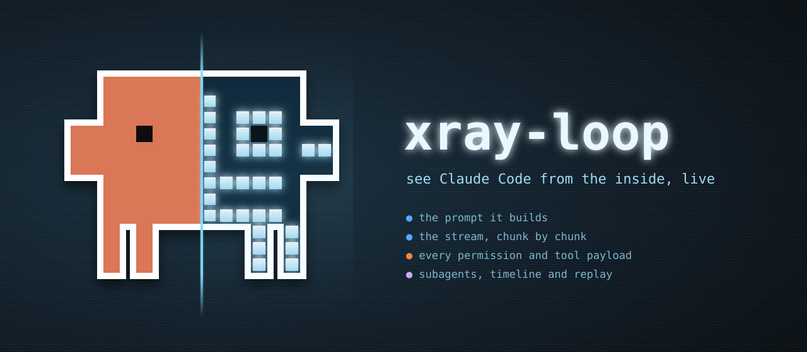

<p align="center">
  
</p>

# xray-loop

**See Claude Code from the inside, live.**

`xray-loop` is a Claude Code mod that opens a pane next to your conversation and shows the agent loop while it runs. It shows the real payloads, not a diagram: the system prompt Claude Code assembled, the messages each request carries, the stream chunk by chunk, every permission verdict, every tool's input and output, and each subagent's own loop. When the turn ends, a timeline lets you replay it.

> Unofficial community project, not affiliated with or endorsed by Anthropic. The x-rayed pixel creature is fan art in the style of Claude Code's mascot.

## Install

At the prompt of a terminal session:

```
/plugin install xray-loop --marketplace raultoto/claude-code-xray
```

Answer `y` to add the marketplace, then pick a scope (user is the first one). The mod is active right away, with no restart.

From a shell:

```
claude plugin install xray-loop --marketplace raultoto/claude-code-xray
```

In the desktop app, where `/plugin` does not run: click **+** next to the prompt box, then **Plugins**, **Add marketplace** with `raultoto/claude-code-xray`, then **Add plugin**.

## Use

Type `/xray-loop` to open the pane, then send any prompt that uses tools. The pane follows the turn live by default, and every new turn is followed again even if you were exploring the last one. Press `ctrl+x tab` to give the pane the keyboard:

| Key | Does |
| --- | --- |
| `h` / `l` | previous / next step of the loop |
| `j` / `k` | move the timeline's playhead back / forward (replay) |
| `f` | follow live again |
| `t` | show / hide the timeline |
| `v` | show the whole text of a long payload |

Clicking a span in the timeline jumps to its step. A terminal of 144 columns or more docks the pane beside the transcript; a narrower one opens it above the prompt.

## What you see

The pane walks the seven steps of the agent loop. Each step shows its payload:

| # | Step | The payload |
| --- | --- | --- |
| 1 | build prompt | the system prompt's sections and where the cache boundary falls, the tools (loaded vs. deferred), and every row the first request carries. Pick one to read its text |
| 2 | send | `POST /v1/messages`: the model, the message count, the rows that are new since the previous request, and the cache read and written |
| 3 | stream | every chunk as it arrives, and the `tool_use` JSON being assembled piece by piece |
| 4 | permission | the `tool.check` verdict, verbatim: `allow`, or `ask` with its reason |
| 5 | run tool | the tool's input and its result. For `Agent`, the subagent's prompt, its own loop and its report |
| 6 | add results | the rows `session.append` stored, which the next request will carry |
| 7 | answer | the text chunks, the answer, the cache usage and the closing hooks |

Above the payload sits a waterfall of the turn: each model request, each tool and each subagent, with a playhead across all of them.

```
                        0s          5.3s        10.5s       15.8s
▸builds the prompt      ██│
 step #0 → model          ░░░░░┃███████████                       5.81 s
   Read                         │█◆                                154 ms
   Agent                        │   ◆████████████████████         7.89 s
     subagent Explore           │    ███████████████████          7.43 s
       step #0 → model          │     ░░░████████                 3.13 s
       Bash                     │            ◆███                 1.32 s
                          ▲  7.21 s
[j: ◂ time] [k: time ▸] [t: hide]  click a span to open its step
```

`░` is the wait for the first token, `█` is work, and `◆` is the permission check. Moving the playhead with `j` / `k` replays the turn as it stood at that moment: the stream shows only the chunks that had arrived (the `tool_use` JSON still half written), and tools still running show as running.

## How it works

`xray-loop` observes the engine's own events through function hooks, and every hook passes the event on unchanged:

| Event | What it records |
| --- | --- |
| `prompt.compose` | the system prompt's sections: `id`, text, and `shared` / `session` scope |
| `tool.describe` | which tools are loaded and which are deferred behind ToolSearch |
| `session.append` | every row the conversation stores, and the door it came in by |
| `turn.step` | each model request and its stream: `thinking`, `tool`, `input` (partial JSON), `text`, `stop` |
| `tool.check`, `tool.call` | the verdict and the tool's input and result |
| `agent.spawn`, `turn.start`, `turn.complete` | subagents and the turn's boundaries |

The code is split by responsibility:

```
hooks/
  recorder.ts   pure: builds the record of the turn from the events
  loop.ts       pure: turns the record into the loop's steps and the timeline's spans
  view.tsx      draws the pane from the record
  register.tsx  the adapter: hooks, the /xray-loop command, the pane
  redact.ts     masks emails and token shapes before anything is stored
```

## Privacy

- Everything stays in the session's memory. Nothing is written to disk and nothing is sent anywhere.
- Emails and common token shapes (`sk-…`, `ghp_…`, `xox?-…`, `AKIA…`) are masked before they are stored.
- Only the current turn is kept, and long texts are cut to 4 KB each (their real size is still shown).
- The pane shows your own system prompt, `CLAUDE.md` and tool outputs. Keep that in mind when you share your screen.

## Cost

Watching is cheap, but not free. `tool.describe` is the only place where the engine says which tools are deferred, and hooking it costs about 0.16 s once per turn: one hop per tool, all in parallel. Each other hook adds about 1 ms.

Where an organization manages Claude Code, hooks on `prompt.compose` only run for plugins listed in managed settings. There, the system section of step 1 stays empty.

## Development

```
claude --plugin-dir .          # run a session with the mod loaded from this folder
claude plugin validate .       # what the engine sees: hooks, state, refusals
claude plugin test .           # the tests, on the terminal and desktop surfaces
```

Built against Claude Code 2.1.300. The function-hook API is early access and may change between releases.
